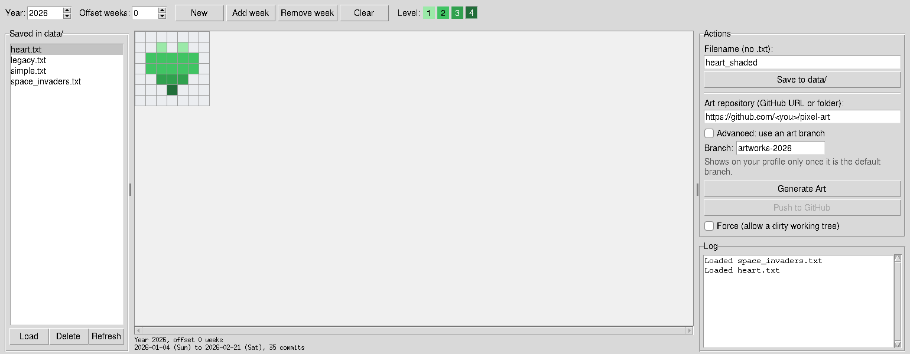
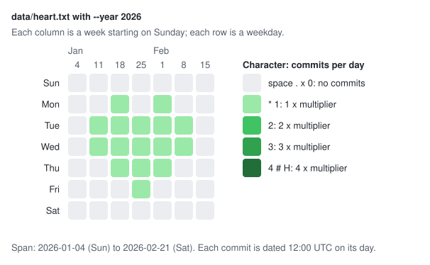

# GitHub pixel artworks

[](https://github.com/simonerigoni/github_pixel_artworks/actions/workflows/ci.yml?query=branch%3Amain) [](LICENSE.md) [](pyproject.toml) [](https://github.com/astral-sh/uv) [](https://github.com/pre-commit/pre-commit) [](https://renovatebot.com)

## Quick start

1. Create an empty repository on GitHub for the art, for example `<you>/pixel-art`. Use a new repository, not a fork and not a clone of this project.
2. Draw an artwork into it. The tool clones the repository into `./pixel-art` and commits on its default branch:

   ```bash
   uv sync
   uv run github-pixel-artworks -i data/heart.txt --year 2025 --target-repo https://github.com/<you>/pixel-art
   ```

3. Push, and the art appears on your profile in that year:

   ```bash
   git -C pixel-art push -u origin main
   ```

   Adding `--push` to step 2 does the same.

The commits must use an email address connected to your GitHub account (`git config user.email`). The tool warns when it can tell that is not the case.

## Introduction

A tool that draws pixel art on your GitHub contribution graph. You design a 7-row artwork, one row per weekday and one column per week. The tool then creates empty, backdated commits so that each pixel shows up as a green square on the right day. It comes with a command line interface and a small Tkinter editor.

## Software and libraries

This project uses Python 3.15 and the most important packages are:

- **GitPython**: git operations and the backdated commits
- **tkinter** (standard library): the GUI editor

## Data

Have a look at the `data` folder and its [DATA.md](data/DATA.md) file.

## Local configuration

To set up a local environment and install all dependencies, run `uv sync` from the project folder.

Then run the checks with:

```bash
uv run pre-commit run --all-files
uv run pytest
```

## Code Quality

Code quality is maintained through automated checks and linting using pre-commit.

Pre-commit is a framework for managing and maintaining multi-language pre-commit hooks. A pre-commit hook is a script that runs before a commit operation in a version control system. This allows to shift left code quality checks and remediations. You can change the hooks by updating the file `.pre-commit-config.yaml`.

To trigger the pre-commit hooks without an actual commit you can run `pre-commit run --all-files -v`.

It is also possible to run manually the individual tools:

- `uv run ruff check --fix`
- `uv run ruff format .`
- `uv run pyright .`

## Testing

Tests are implemented using `pytest` and coverage is tracked with `pytest-cov`. The detailed coverage report is generated by the pre-commit hook and it is available in [COVERAGE.md](COVERAGE.md) file.

The GUI tests need a display. On Linux, including CI, `pytest-xvfb` starts a virtual one when `Xvfb` is installed; elsewhere they use your desktop or are skipped.

It is also possible to run manually the individual tests:

- `uv run pytest`

## Running the code

### CLI

```bash
uv run github-pixel-artworks --help
```

Preview where `data/heart.txt` would land in 2020 without committing anything:

```bash
uv run github-pixel-artworks -i data/heart.txt --year 2020 --dry-run
```

Draw it into your art repository and push it:

```bash
uv run github-pixel-artworks -i data/heart.txt --year 2020 --target-repo https://github.com/<you>/pixel-art --push
```

Main options:

- `-i, --input`: the artwork file (required)
- `--year`, `--start-date` or `--auto-align`: where the art starts (one is required). `--year` starts on the first Sunday of that year, and `--offset-weeks` shifts it to the right.
- `-t, --target-repo`: your art repository, as a GitHub URL (cloned into a folder of the same name, or reused if it is already there) or a local path. The commits go on its default branch. The tool refuses to draw into a checkout of this project.
- `--push`: push to `origin` afterwards
- `--multiplier N`: commits per intensity level (default 1)
- `--username NAME`: scale the intensity so level 4 matches your darkest existing day
- `--dry-run`, `--yes`, `--force`: preview only, skip the confirmation, allow a dirty working tree
- `--art-branch NAME` (advanced): commit on `NAME` instead, creating it if needed, then return to your branch with your uncommitted changes restored. The art only shows on your profile once that branch is merged into the default branch or made the default.

### GUI

```bash
uv run github-pixel-artworks-gui
```

Pick a level from 1 to 4 (GitHub's four greens) and click or drag on the grid to paint. Clicking a cell that already has the selected level erases it. You can add or remove weeks, choose the year and offset, and save drawings to or load them from `data/` with their levels kept. Enter your art repository (a GitHub URL or a folder), then **Generate Art** creates the commits on its default branch and **Push to GitHub** pushes them. An art branch is available as an advanced option.




## Results

Each column of the artwork is a week starting on Sunday, and each row is a day. A pixel at level `n` becomes `n x multiplier` empty commits, all dated 12:00 UTC on that day. GitHub groups contributions by UTC day, so the time keeps the pixel on its square whatever your local timezone. More commits make the square a darker green.



The diagram is generated from the package's own loader and date logic with `uv run python scripts/render_grid_diagram.py`.

GitHub only counts a commit on your profile if it meets three conditions:

- it is on the repository's **default branch** (or `gh-pages`)
- it is authored with an email address connected to your account
- it is not in a fork

The tool handles these by default. It commits on the default branch of a repository you own, refuses this project's own checkout, and warns when the repository is a fork or `user.email` is unset or is the no-reply address of another account. See GitHub's [troubleshooting guide](https://docs.github.com/en/account-and-profile/reference/why-are-my-contributions-not-showing-up-on-my-profile). Contributions in private repositories only appear if you show private contributions on your profile.

The package is organised as:

- `artwork.py`: the file format and intensity levels
- `dates.py`: the calendar placement
- `art_repo.py`: finding, cloning and pushing the art repository
- `github.py`: usernames, the contribution calendar, remote URLs, and the email and fork checks
- `painter.py`: `apply_drawing`, which creates the commits
- `cli.py` and `gui.py`: the two front ends

## List of activities

In the [TODO.md](TODO.md) file you can find the list of tasks and ongoing activities.

## Licensing and acknowledgements

Have a look at [LICENSE.md](LICENSE.md) and many thanks to [jarreed0](https://github.com/jarreed0/contributionartwork) for the inspiration.

## Outro

I hope this repository was interesting and thank you for taking the time to check it out. On my Medium you can find a more in depth [story](https://medium.com/@simone-rigoni01/) and on my Blogspot you can find the same [post](https://simonerigoni01.blogspot.com/) in Italian. Let me know if you have any question and if you like the content that I create feel free to [buy me a coffee](https://www.buymeacoffee.com/simonerigoni).