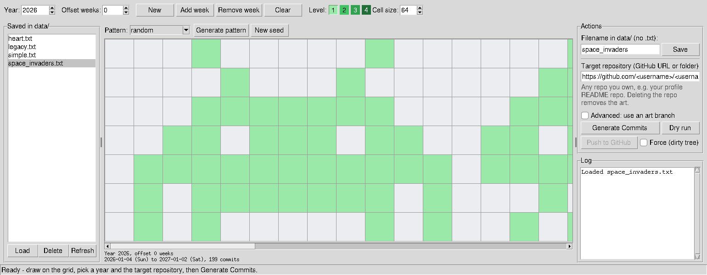
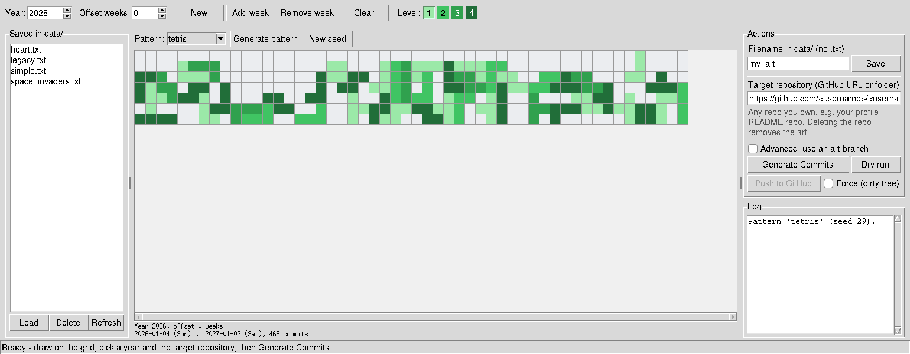

# GitHub pixel artworks

[](https://github.com/simonerigoni/github_pixel_artworks/actions/workflows/ci.yml?query=branch%3Amain) [](LICENSE.md) [](pyproject.toml) [](https://github.com/astral-sh/uv) [](https://github.com/pre-commit/pre-commit) [](https://renovatebot.com)

## Quick start

The recommended target is your profile README repository, `<username>/<username>`, but any repository you own works. The tool clones a URL target into `target_cloned_repo/<repo>` at the root of this project (the folder that contains `pyproject.toml`, found from the package location, so not from the working directory) and adds **empty** commits on its default branch, so no file in it changes. Once the art is pushed, that clone is deleted. The folder is listed in `.gitignore`.

`--target-repo` is optional when the tool can find your GitHub username. It reads the git settings in effect where you run it (the repository's, your global and system ones) and stops at the first hit, saying which one it used:

1. `git config github.user`
2. a no-reply `user.email` (`<id>+<username>@users.noreply.github.com`)
3. `user.name`, if it looks like a GitHub username (1 to 39 letters, digits or single inner hyphens, no spaces). This is a guess, so it says so.
4. GitHub's public commit search for your `user.email`: one unauthenticated request with a short timeout. It finds you only if a public commit of yours uses that address, and any failure or rate limit is skipped silently.
5. `gh api user`, if the GitHub CLI is installed

To be sure, set it once:

```bash
git config --global github.user <username>
```

1. Preview where the art lands and how many commits it adds (add `--target-repo https://github.com/<username>/<username>` if your username is not detected):

   ```bash
   uv sync
   uv run github-pixel-artworks -i data/heart.txt --year 2025 --dry-run
   ```

2. Draw it and push it, and the art appears on your profile in that year:

   ```bash
   uv run github-pixel-artworks -i data/heart.txt --year 2025 --push
   ```

3. Running the same drawing again adds nothing, and a higher `--multiplier` adds only the difference.

Without `--push`, the commits exist only in that clone, so it is kept: the tool prints its path and the `git -C <path> push` command to publish them. If drawing or pushing fails, the clone is kept only when it holds unpushed art commits (its path is printed); otherwise it is deleted. `--keep-clone` always keeps it. A local path given as the target is never deleted. If `target_cloned_repo/<repo>` is already there from an earlier run, the tool reuses it when it is a clone of the same URL: a clean clone is updated from the remote; a clone that still holds unpushed commits is left as it is. If the folder is something else, or has uncommitted changes, the tool stops and asks you to move or delete it.

The commits are authored with the git identity (`user.name` and `user.email`) of the target repository if it has its own, otherwise the one in effect where you run the tool: this checkout's local config, then your global and system config. If none is set, the tool stops before cloning anything and tells you to run `git config --global user.email <an email on your GitHub account>` (and `user.name`). The email must be connected to your GitHub account; the tool warns when it can tell that is not the case.

Trade-offs: the art adds extra empty commits to that repository's log (one per shade step of each pixel, from dozens to a few hundred), and deleting the repository (or rewriting its history) removes the art from your profile.

## Introduction

A tool that draws pixel art on your GitHub contribution graph. You design a 7-row artwork, one row per weekday and one column per week. The tool then creates empty, backdated commits so that each pixel shows up as a green square on the right day. It comes with a command line interface and a small Tkinter editor.

## Software and libraries

This project uses Python 3.15 and the most important packages are:

- **GitPython**: git operations and the backdated commits
- **tkinter** (standard library): the GUI editor

## Data

Have a look at the `data` folder and its [DATA.md](data/DATA.md) file.

## Local configuration

To set up a local environment and install all dependencies, run `uv sync` from the project folder.

Then run the checks with:

```bash
uv run pre-commit run --all-files
uv run pytest
```

## Code Quality

Code quality is maintained through automated checks and linting using pre-commit.

Pre-commit is a framework for managing and maintaining multi-language pre-commit hooks. A pre-commit hook is a script that runs before a commit operation in a version control system. This allows to shift left code quality checks and remediations. You can change the hooks by updating the file `.pre-commit-config.yaml`.

To trigger the pre-commit hooks without an actual commit you can run `pre-commit run --all-files -v`.

It is also possible to run manually the individual tools:

- `uv run ruff check --fix`
- `uv run ruff format .`
- `uv run pyright .`

## Testing

Tests are implemented using `pytest` and coverage is tracked with `pytest-cov`. The detailed coverage report is generated by the pre-commit hook and it is available in [COVERAGE.md](COVERAGE.md) file.

The GUI tests need a display. On Linux, including CI, `pytest-xvfb` starts a virtual one when `Xvfb` is installed; elsewhere they use your desktop or are skipped.

It is also possible to run manually the individual tests:

- `uv run pytest`

## Running the code

### CLI

```bash
uv run github-pixel-artworks --help
```

Preview where `data/heart.txt` would land in 2020 without committing anything:

```bash
uv run github-pixel-artworks -i data/heart.txt --year 2020 --dry-run
```

Draw it into your profile README repository and push it:

```bash
uv run github-pixel-artworks -i data/heart.txt --year 2020 --target-repo https://github.com/<username>/<username> --push
```

Main options:

- `-i, --input`: the artwork file (required unless `--pattern` is used)
- `--year`, `--start-date` or `--auto-align`: where the art starts (one is required). `--year` starts on the first Sunday of that year, and `--offset-weeks` shifts it to the right.
- `-t, --target-repo`: a repository you own, such as your profile README repository, as a GitHub URL (cloned into `target_cloned_repo/<repo>` at this project's root, see [Quick start](#quick-start)) or a local path. The empty commits go on its default branch. It defaults to the profile README repository of the detected GitHub user (see [Quick start](#quick-start)). The tool refuses to draw into a checkout of this project.
- `--push`: push to `origin` afterwards, then delete the clone of a URL target
- `--keep-clone`: keep the clone of a URL target in `target_cloned_repo/`
- `--multiplier N`: commits per intensity level (default 1)
- `--username NAME`: scale the intensity so level 4 matches your darkest existing day
- `--pattern NAME`: generate a grid instead of `-i` (`random`, `mirror`, `wave`, `tetris`, or `text`). `--pattern-text` is required with `text`; `--seed N` reproduces a result.
- `--dry-run`: preview only. With a target repository (given or detected) it also runs every check and reports how many commits are new.
- `--yes`, `--force`: skip the confirmation, allow a dirty working tree
- `--art-branch NAME` (advanced): commit on `NAME` instead, creating it if needed, then return to your branch with your uncommitted changes restored. The art only shows on your profile once that branch is merged into the default branch or made the default.

### GUI

```bash
uv run github-pixel-artworks-gui
```

Pick a level from 1 to 4 (GitHub's four greens) and click or drag on the grid to paint. Clicking a cell that already has the selected level erases it. You can add or remove weeks, choose the year and offset, and save drawings to or load them from `data/` with their levels kept. The target repository is pre-filled with your profile README repository when your GitHub username is detected (see [Quick start](#quick-start)); otherwise enter one, for example `https://github.com/<username>/<username>`. **Dry run** reports how many commits are new, **Generate Commits** adds them on the default branch, and **Push to GitHub** pushes them and then deletes the clone of a URL target in `target_cloned_repo/` (kept until then, with its path in the log). An art branch is available as an advanced option.




The **Pattern** bar above the grid can fill it with a generated pattern (random, a left-right mirror, a wave, stacked Tetris blocks, or centred pixel-font text). You can still paint by hand afterwards, then **Generate Commits**.



Preview a seeded Tetris board without committing:

```bash
uv run github-pixel-artworks --pattern tetris --seed 29 --year 2026 --dry-run
```

Draw text, such as a name, into your profile README repository:

```bash
uv run github-pixel-artworks --pattern text --pattern-text SIMONE --year 2026 --push
```

## Results

Each column of the artwork is a week starting on Sunday, and each row is a day. A pixel at level `n` becomes `n x multiplier` empty commits, all dated 12:00 UTC on that day. GitHub groups contributions by UTC day, so the time keeps the pixel on its square whatever your local timezone. More commits make the square a darker green.


The diagram is generated from the package's own loader and date logic with `uv run python scripts/render_grid_diagram.py`. The GUI screenshots are recaptured with `xvfb-run -a -s "-screen 0 1920x1080x24" uv run python scripts/capture_gui_screenshots.py`.

GitHub only counts a commit on your profile if it meets three conditions:

- it is on the repository's **default branch** (or `gh-pages`)
- it is authored with an email address connected to your account
- it is not in a fork

The tool handles these by default. It commits on the default branch of a repository you own, refuses this project's own checkout, and warns when the repository is a fork or `user.email` is unset or is the no-reply address of another account. See GitHub's [troubleshooting guide](https://docs.github.com/en/account-and-profile/reference/why-are-my-contributions-not-showing-up-on-my-profile). Contributions in private repositories only appear if you show private contributions on your profile.

The package is organised as:

- `config.py`: every named constant, grouped by topic
- `artwork.py`: the file format and intensity levels
- `dates.py`: the calendar placement
- `art_repo.py`: finding, cloning a URL into `target_cloned_repo/`, pushing and deleting the target repository
- `identity.py`: the git identity the commits are made with
- `github.py`: usernames and their detection, the contribution calendar, remote URLs, and the email and fork checks
- `patterns.py`: generated grids (random, mirror, wave, tetris, text) used by the CLI and GUI
- `painter.py`: `apply_drawing`, which creates the commits
- `cli.py` and `gui.py`: the two front ends

## List of activities

In the [TODO.md](TODO.md) file you can find the list of tasks and ongoing activities.

## Licensing and acknowledgements

Have a look at [LICENSE.md](LICENSE.md) and many thanks to [jarreed0](https://github.com/jarreed0/contributionartwork) for the inspiration.

## Outro

I hope this repository was interesting and thank you for taking the time to check it out. On my Medium you can find a more in depth [story](https://medium.com/@simone-rigoni01/) and on my Blogspot you can find the same [post](https://simonerigoni01.blogspot.com/) in Italian. Let me know if you have any question and if you like the content that I create feel free to [buy me a coffee](https://www.buymeacoffee.com/simonerigoni).